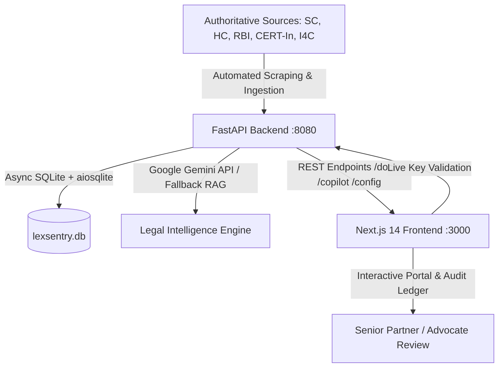

# ⚖️ Cyber Law Watch Agent

> **Autonomous Regulatory & Judicial Intelligence Counsel for Indian Cyber Law Practice**  
> Real-time monitoring of Supreme Court & High Court precedents, RBI directions, CERT-In advisories, and I4C/NCRP protocols with automated CMS matter impact mapping and Gemini-powered legal RAG copilot.

---

## 📋 Executive Overview

The **Cyber Law Watch Agent** is an end-to-end autonomous intelligence and regulatory compliance system designed specifically for Indian cyber litigation practitioners, law firms, and fintech compliance counsels.

It continuously tracks legal shifts in cyber jurisprudence—including **Section 102 Cr.P.C. / Section 106 BNSS bank account debit freezes**, **mule account cascades**, **digital arrest extortion syndicates**, **CERT-In 6-hour reporting mandates**, and **RBI cyber security directions**. It filters out noise, extracts verified transcripts, scores relevance (P0/P1/P2), matches rulings against active client case files, and arms advocates with court-ready petition clauses and client advisories.

---

## 🏛️ Jurisdictional Source Architecture

The agent strictly enforces judicial hierarchy. **District and Taluka courts (`services.ecourts.gov.in`) are explicitly excluded** as they do not set binding appellate precedent. The system ingests and cross-verifies from:

| Authority Tier | Regulatory / Judicial Body | Official Registry Portal | Verified 3rd-Party Report |
| :--- | :--- | :--- | :--- |
| **Apex Court (SC)** | **Supreme Court of India** | [sci.gov.in](https://www.sci.gov.in) | [Indian Kanoon](https://indiankanoon.org/doc/119330990/) |
| **High Court (HC)** | **High Court of Delhi** | [delhihighcourt.nic.in](https://delhihighcourt.nic.in) | [Indian Kanoon](https://indiankanoon.org/doc/157291125/) |
| **High Court (HC)** | **High Court of Karnataka** | [karnatakahiqhicourt.kar.nic.in](https://karnatakahiqhicourt.kar.nic.in) | [Indian Kanoon](https://indiankanoon.org/doc/135967005/) |
| **High Court (HC)** | **High Court of Judicature at Bombay** | [bombayhighcourt.nic.in](https://bombayhighcourt.nic.in) | [Indian Kanoon](https://indiankanoon.org/search/?formInput=bombay+high+court+section+102+crpc+bank+freeze) |
| **High Court (HC)** | **High Court for the State of Telangana** | [tshc.gov.in](https://tshc.gov.in) | [Indian Kanoon](https://indiankanoon.org/search/?formInput=telangana+high+court+cyber+crime+mule+account) |
| **Regulator (REG)** | **Reserve Bank of India (RBI)** | [rbi.org.in](https://rbi.org.in) | [RBI Circulars Index](https://www.rbi.org.in/Scripts/BS_CircularIndexDisplay.aspx) |
| **Regulator (REG)** | **CERT-In (MeitY)** | [cert-in.org.in](https://www.cert-in.org.in) | [CERT-In Advisory Gazette](https://www.cert-in.org.in/advisories.jsp) |
| **Ministry (MIN)** | **Ministry of Home Affairs / I4C (NCRP 1930)** | [cybercrime.gov.in](https://cybercrime.gov.in) | [NCRP 1930 Portal SOP](https://cybercrime.gov.in/) |

---

## ⚡ Core Features & Capabilities

### 1. Structured Audit Ledger (Project Brief Page 5)
* Real-time ledger displaying Title & Citation, Authority & Verified Source, Document Type, Ingestion Date, Topic Tags, Priority Score (P0/P1/P2), Matched Matters, and Lawyer Review status.
* Dual links for each development: direct link to the **Official Court Registry** and the verified **3rd-Party Legal Article / Report**.

### 2. Verified Full-Text Transcript & Evidence Viewer
* Every ruling contains complete verbatim certified transcripts (2,000–4,600 characters) covering Appearances, Factual Matrices, Statutory Interpretation, and Operative Orders.
* Embedded **Evidence Viewer** toggles between the authentic certified PDF and structured text with an instant **"Copy Extracted Text"** clipboard button.

### 3. CMS Matter Impact Mapping (Brief Phase 4)
* Automatically cross-references incoming rulings against internal law firm practice files (e.g. `CY-2024-088` Apex Fintech Corp, `CY-2024-142` FinSecure Payments, `CY-2024-201` Vigilance Tech Labs).
* **T-63 Litigation Task Generator**: Generates actionable associate action plans (Court filings, Magistrate notices, compliance audits).
* **AI Client Advisory Generator**: Drafts partner-grade email updates ready to send to corporate clients with subject line and markdown body.

### 4. Cyber Practice Intelligence Copilot (Legal RAG)
* Multi-turn conversational legal intelligence powered by Google Gemini with fallback to verified local statutory ratios.
* **Statutory Drafting Engine**: Drafts court-ready applications under **Section 457 Cr.P.C. / Section 503 BNSS, 2023** and statutory demand notices to Bank Nodal Officers.
* **Dual Quoted Sources**: Every answer quotes exact certified PDF filenames (e.g., `[Certified PDF: /docs/kar_hc_28912_2024.pdf]`) and provides clickable links.
* **Panoramic View**: Expandable drawer with Standard View (660px) and Panoramic View (920px), session reset (`RotateCcw`), and zero visual button clipping.

### 5. In-App Gemini API Key Deployment & Live Diagnostics Panel
* Built-in configuration modal to test, validate, and rotate Google Gemini API keys without SSH or server reboots.
* Live roundtrip ping against Google AI's model catalog displaying ping latency, model access confirmation, and error diagnostics.
* Hot-reloads in-memory backend settings and updates `backend/.env` automatically.

---

## 🛠️ Architecture & Tech Stack



* **Frontend**: Next.js 14 (App Router), React 18, Tailwind CSS, Lucide React, React-Markdown.
* **Backend**: FastAPI, Uvicorn, Python 3.11+, SQLAlchemy 2.0 (Async), Pydantic v2, HTTPX.
* **Database**: SQLite with `aiosqlite` driver (zero external database configuration required).
* **AI Engine**: Google Gemini API (`gemini-flash-latest` / `gemini-2.5-flash`) via direct async REST calls.

---

## 🚀 Quickstart: Running Locally

### Prerequisites
* **Python**: 3.10 or higher
* **Node.js**: v18 or higher (with npm)

### 1. Clone & Setup Environment
```bash
git clone https://github.com/your-org/cyber_watch_agent.git
cd cyber_watch_agent
```

### 2. Configure Environment Variables
Copy `.env.example` to `.env` in the `backend/` directory:
```bash
cp backend/.env.example backend/.env
```
Edit `backend/.env` and insert your Gemini API Key (or configure it via the web UI later):
```env
APP_ENV=development
SECRET_KEY=change-me-in-production-use-openssl-rand-hex-32
GEMINI_API_KEY=your_gemini_api_key_here
STORAGE_DIR=./storage
CORS_ORIGINS=http://localhost:3000,http://127.0.0.1:3000
```
> 💡 *Note: If you do not have a Gemini API key yet, the application will run seamlessly using its built-in certified legal RAG intelligence and allow you to add your key through the in-app configuration panel.*

### 3. Launch Both Servers with One Command
Run the unified Python orchestrator:
```bash
python run.py
```
This single command:
1. Validates prerequisites (Python & Node.js).
2. Spawns the FastAPI backend on `http://127.0.0.1:8080`.
3. Spawns the Next.js frontend on `http://localhost:3000`.
4. Streams colored logs (`[BACKEND]` in green, `[FRONTEND]` in cyan).
5. Automatically verifies health checks and launches your browser at `http://localhost:3000`.
6. Handles graceful cleanup on `Ctrl+C`.

*(Alternatively, on Windows you can double-click `run_all.bat` or run `.\run_all.ps1`)*

---

## 🌐 Production Deployment Guide

### Deploying via Docker (Recommended)

#### Option A: Docker Compose
Create a `docker-compose.yml`:
```yaml
version: '3.8'

services:
  backend:
    build:
      context: ./backend
      dockerfile: Dockerfile
    ports:
      - "8080:8080"
    environment:
      - APP_ENV=production
      - GEMINI_API_KEY=${GEMINI_API_KEY}
      - CORS_ORIGINS=http://localhost:3000,https://yourdomain.com
    volumes:
      - ./backend/lexsentry.db:/app/lexsentry.db

  frontend:
    build:
      context: ./frontend
      dockerfile: Dockerfile
    ports:
      - "3000:3000"
    environment:
      - NEXT_PUBLIC_API_URL=http://backend:8080
    depends_on:
      - backend
```

#### Option B: Cloud Hosting (Render / Railway / Cloud Run)
1. **Backend**:
   - Build Command: `pip install -r requirements.txt`
   - Start Command: `uvicorn app.main:app --host 0.0.0.0 --port 8080`
   - Environment Variable: `GEMINI_API_KEY="your-key-here"`
2. **Frontend**:
   - Build Command: `npm run build`
   - Start Command: `npm run start`
   - Environment Variable: `NEXT_PUBLIC_API_URL="https://your-backend-url.com"`

---

## 📡 REST API Reference

The FastAPI backend exposes an interactive OpenAPI Swagger UI at `http://127.0.0.1:8080/docs`:

| Method | Endpoint | Description |
| :--- | :--- | :--- |
| `GET` | `/api/v1/documents/` | Retrieve all indexed judicial precedents and regulatory circulars. |
| `POST` | `/api/v1/documents/sync` | Trigger live ingestion watchdog and synchronize incoming rulings. |
| `POST` | `/api/v1/documents/{id}/review` | Record advocate sign-off (Default: `Adv. Amit Kumar Gupta (MD)`). |
| `POST` | `/api/v1/copilot/ask` | Query the Gemini Legal RAG engine with multi-turn history. |
| `POST` | `/api/v1/alert/generate` | Generate formal client advisory email from certified rulings. |
| `GET` | `/api/v1/config/gemini-status` | Return configuration state, active model, and masked API key. |
| `POST` | `/api/v1/config/gemini-validate` | Live roundtrip verification of Gemini API key against Google AI. |
| `POST` | `/api/v1/config/gemini-save` | Persist new API key to `.env` and hot-reload in memory. |

---

## 🤝 Website Integration

To embed the **Cyber Law Watch Copilot** or **Audit Ledger** into an existing law firm portal (WordPress, Webflow, custom React), refer to the detailed guide:
👉 [WEBSITE_INTEGRATION_GUIDE.md](file:///c:/cyber_watch_agent/WEBSITE_INTEGRATION_GUIDE.md)

---

## 📄 License & Confidentiality

Developed for authoritative Indian cyber law practice and regulatory intelligence.  
*All judicial citations and statutory references are based on certified copies from the Supreme Court of India, High Courts, Reserve Bank of India, and CERT-In.*
# cyberlaw-watchdog

